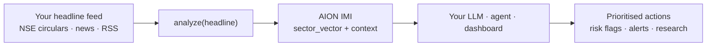
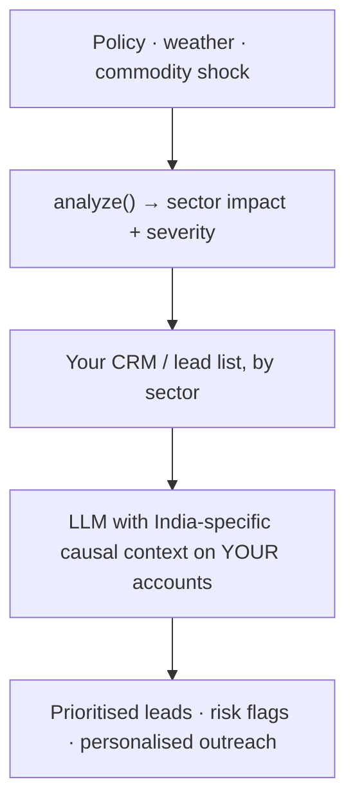

[](https://pypi.org/project/aion-indian-market-intelligence/)

# AION Indian Market Intelligence for Macro Event & Sector Impact Analysis

**An API that turns an Indian financial headline into a signed sector vector —
which sectors are exposed, in which direction, and who is affected.**

A sentiment score says `negative 0.82`. Negative *for whom?* One event moves
different sectors in opposite directions, and a single number has to pick one and
discard the rest.

## What it does



## Quickstart in 60 seconds

```bash
pip install aion-indian-market-intelligence
export AION_API_KEY="<your_api_key>"
```

```python
from aion_indian_market_intelligence import analyze

intel = analyze("RBI hikes repo rate by 25 bps")
print(intel["sector_vector"])
# {'Information Technology': 0.18, 'Realty': -0.52,
#  'Financial Services': -0.31, 'Automobile and Auto Components': -0.26}
```

Get a key at
[dashboard.aiondashboard.site/access/register](https://dashboard.aiondashboard.site/access/register).
The free tier is 1,000 requests a month.

## What this is NOT

> - **Not investment advice.** It describes exposure; it does not tell you what to do about it.
> - **Not a trading signal.** There is no entry, exit, target or position size anywhere in the output.
> - **Not a downloadable model.** Inference runs through the hosted API. This repository contains no weights, coefficients, taxonomy files or server code.

## Before / After

The same headline, through a polarity model and through this one:

> Unseasonal rainfall and hailstorm hit apple orchards in Himachal Pradesh in April

| | Polarity-only NLP | AION IMI |
| --- | --- | --- |
| **Output** | `negative` | `event: rain_apple_damage` |
| **Which sectors** | — | Agriculture & Horticulture, Transportation, Consumer Services under pressure |
| **Flip side** | — | storage-linked and substitute supply chains may benefit |
| **Who is affected** | — | producer losses · policymaker inflation watch · investor attention on second-order effects |
| **Actionable by a system** | not really | yes — it names sectors you can join to your own data |

Market implication: agriculture-linked exposure under pressure, logistics
bottlenecks possible, substitute supply chains may benefit.

## Use Cases

Three patterns, all of which people are already building. Longer write-ups in
[the DEV.to article](https://dev.to/aion-analytics-india/aion-indian-market-intelligence-the-india-contextual-intelligence-layer-for-your-llms-and-saas-4eam).

### 1. LLM / RAG augmentation

*For AI engineers.* Store the sector vector next to the headline in your vector
store. When the LLM retrieves the document it also retrieves India-specific
impact context, so it reasons about the event rather than paraphrasing it.

```python
intel = analyze(headline)
enriched = (
    f"Headline: {headline}\n"
    f"Sector impact: {intel['sector_vector']}\n"
    f"Stakeholders: {intel.get('stakeholder_views')}"
)
# embed `enriched`, or store the vector as metadata alongside the headline
```

### 2. SaaS sales & CRM intelligence

*For B2B SaaS founders.* Map a macro event onto your own customer list by sector.
Instead of "this is negative", your system knows which accounts sit in the
affected sectors, in which direction, and how hard.



```python
intel = analyze(event_headline)
for account in crm.accounts:
    exposure = intel["sector_vector"].get(account.sector, 0.0)
    if abs(exposure) > 0.25:
        account.flag(f"{event_headline} → {exposure:+.2f}")
```

### 3. Research & analyst workflows

*For analysts and journalists.* Batch a feed of headlines into structured impact
objects, then review the ones that matter instead of reading everything.

```python
from aion_indian_market_intelligence import analyze

for item in my_news_feed:
    intel = analyze(item["headline"])
    item["imi_sector_vector"] = intel["sector_vector"]
    item["imi_top_positive"] = intel["top_positive_sectors"]
    # store, sort by magnitude, or route for human review
```

## API Contract

Production usage flows through the managed AION API:

- `POST https://api.aiondashboard.site/v1/analyze`
- header:
  - `X-API-Key: <key>`

```python
import requests

headers = {"X-API-Key": "YOUR_API_KEY"}
resp = requests.post(
    "https://api.aiondashboard.site/v1/analyze",
    headers=headers,
    json={"headline": "RBI hikes repo rate by 25 bps"},
    timeout=30,
)
resp.raise_for_status()
print(resp.json()["sector_vector"])
```

Canonical import:

```python
from aion_indian_market_intelligence import analyze
```

## Output Contract

Observed top-level output keys:

```json
{
  "headline": "string",
  "confidence": "float",
  "vix_regime": "string",
  "sector_vector": {},
  "top_positive_sectors": {},
  "top_negative_sectors": {},
  "sector_directional_bias": {
    "positive_bias": [],
    "negative_bias": []
  },
  "stakeholder_views": {}
}
```

Canonical key note:

- `sector_vector` is the canonical output key for sector impact analysis
- there is no `sector_impacts` key in the public output contract

## Output-Centric Example

Input:

```text
RBI unexpectedly raises repo rate by 50 bps
```

Example view:

```json
{
  "sector_vector": {
    "Information Technology": 0.18,
    "Realty": -0.52,
    "Financial Services": -0.31,
    "Automobile and Auto Components": -0.26
  },
  "top_positive_sectors": {
    "Information Technology": 0.18
  },
  "top_negative_sectors": {
    "Realty": -0.52,
    "Financial Services": -0.31,
    "Automobile and Auto Components": -0.26
  },
  "macro_effects": {
    "liquidity": "tightening",
    "credit_growth": "slowing",
    "policy_impact_mapping": "rate-sensitive sectors under pressure"
  }
}
```

This is macroeconomic event API output for Indian Market Intelligence for Macro
Event & Sector Impact Analysis. It is structured interpretation, not advice.

## What AION Indian Market Intelligence for Macro Event & Sector Impact Analysis Does

- provides Indian macro event intelligence from financial headlines
- provides sector impact analysis through the canonical `sector_vector`
- supports financial causality mapping and event-to-sector reasoning
- returns sector exposure intelligence for dashboards, agents, and internal tooling
- supports policy impact mapping and event-driven financial inference without
  collapsing into execution language

## Why Not Polarity-Only NLP?

Most open-source financial NLP tools stop at polarity scoring.

| Capability | AION Indian Market Intelligence for Macro Event & Sector Impact Analysis | Polarity-only NLP |
|---|---|---|
| Indian market event logic | Yes | No |
| Sector impact analysis | Yes | No |
| Sector exposure intelligence | Yes | No |
| Policy impact mapping | Yes | No |
| Stakeholder decomposition | Yes | No |
| Macroeconomic event API workflow | Yes | No |
| Financial event ontology | Yes | No |

Polarity-only NLP tells you whether a headline reads positive or negative.

AION Indian Market Intelligence for Macro Event & Sector Impact Analysis tells you:

- what happened
- which sectors are affected and in what direction
- who gains and who loses
- whether there is a flip side
- what the evidence layer suggests for further human or system review

## Canonical vocabulary

`Indian Market Intelligence for Macro Event & Sector Impact Analysis` is the
single public identity phrase, used across docs, model cards, PyPI, MCP copy and
dashboard pages.

<details>
<summary>Supporting vocabulary (maintained for search and retrieval indexing)</summary>

macro event intelligence · sector impact analysis · sector propagation engine ·
financial causality mapping · market impact ontology · event-to-sector reasoning ·
macroeconomic event API · sector exposure intelligence · policy impact mapping ·
event-driven financial inference · financial event ontology · sectoral impact engine

These phrases are intentional for human search, PyPI discovery, Hugging Face
indexing, GitHub topics, MCP registry copy and LLM retrieval embeddings. The
canonical list lives in `docs/CANONICAL_VOCABULARY.yml`.

</details>

## Pricing & Tiers (Draft — Current as of May 2026)

All tiers require an API key. Sign up at
`https://dashboard.aiondashboard.site/access/register`

| Tier | Requests/month | Latency |
|---|---:|---|
| Free | 1,000 | Shared |
| Builder | 15,000 | Shared |
| Pro | 75,000 | Priority |
| Power | 250,000 | Dedicated |

Enterprise: custom, GPU-dedicated. Contact via dashboard.

## Current Limits

- production usage is quota-controlled at the API layer
- weather and crop coverage still depends on explicit cues in the headline
- sparse headlines can remain ambiguous
- pricing and latency tiers above are current commercial positioning and may evolve
- this repository does not contain model weights, production coefficients, private taxonomy files, training scripts, or backend API server code
- the PyPI package provides client tooling only. Production inference requires the hosted API.

## Access And Links

- API gateway:
  - `https://dashboard.aiondashboard.site/systems/api-gateway`
- Website model page:
  - `https://dashboard.aiondashboard.site/models/indian-market-intelligence`
- API key registration:
  - `https://dashboard.aiondashboard.site/access/register`
- Managed API:
  - `https://api.aiondashboard.site/v1/analyze`
- PyPI package:
  - `https://pypi.org/project/aion-indian-market-intelligence/`
- GitHub repository:
  - `https://github.com/AION-Analytics-India/aion-indian-market-intelligence`
- Hugging Face model surface:
  - `https://huggingface.co/AION-Analytics/aion-indian-market-intelligence`
- Hugging Face demo Space:
  - `https://huggingface.co/spaces/AION-Analytics/aion-indian-market-intelligence`
- MCP server repo:
  - `https://github.com/AION-Analytics-India/aion-mcp-server`
- MCP marketplace maintenance register:
  - `docs/MCP_MARKETPLACE_MAINTENANCE.md`

## License

- `packages/aion-newsimpact`, `packages/aion-sectormap` and `packages/aion-volweight` are open source under Apache-2.0; see the `LICENSE` file in each package.
- Everything else in this repository (the Indian Market Intelligence client, MCP wrapper, model card and demo) is **proprietary — hosted API access only. No model weights are distributed. Not open-source.**
